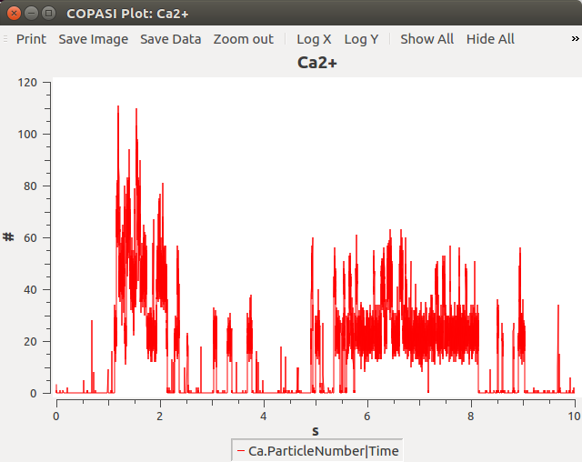

This is the readme for the model associated with the paper:

Antunes G, Sebastiao AM, Simoes de Souza FM (2014) Mechanisms of 
regulation of olfactory transduction and adaptation in the olfactory 
cilium. *PLoS One* 9:e105531

This model was contributed by Fabio Marques Simoes de Souza.

COPASI, free software, is required for this model and is available, 
along with documentation, from [http://www.copasi.org/](http://www.copasi.org/)

Example Usage: 
-------------- 
Start COPASIUI and open model_treatment.cps. Select Time Course and click on Run. You should see a graph of Ca2+ generated:

The figures in the paper are the mean results from hundreds 
of single runs. The screen shot reproduces a single 
run of the model. Supplementary figure S3, first column (A to E) shows 
the example of 5 single runs. The first column of Fig. S3 panel F shows 
the mean result of hundred simulations. We used the Condor Copasi 
platform to do it automatically:  
[https://www.nimml.org/tools/copasi-suite/condor-copasi](https://www.nimml.org/tools/copasi-suite/condor-copasi) 
(There is a similar relationship between model_control.cps and supplementary figure 2).

---

2025-07-09: Converted README to Markdown.
